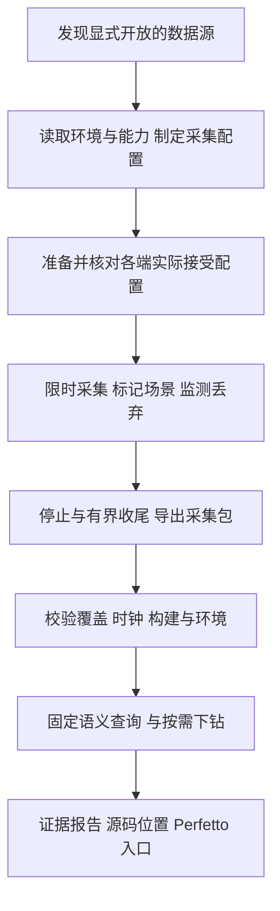

# Agent 采集与分析流程设计

本页定义整体工作流；第一版 CLI 已可调用，准确命令见 [运行指引](../standards/mvp-usage.md)。MCP 和超出第一版的接口仍为后续设计。插件边界、构建开关与数据口径以 [插件设计](profile-plugin.md) 为准。

协议字段、时钟与误差、身份、丢弃和 Perfetto 映射见 [采集协议](capture-protocol.md)。默认保留已有记录、满时丢新详细事件，循环覆盖显式选择，见 [ADR-004](../../decisions/ADR-004-trace-overflow-policy.md)。

控制协调、导出转换与分析位于独立工具包，包边界已由 [ADR-003](../../decisions/ADR-003-runtime-subpaths-and-independent-tools.md) 确认；具体职责见 [SDK 接口与包结构](sdk-contract.md)。CLI 为候选基础入口，后续 MCP 包装同一服务，不建立第二套采集状态机。三端装配与候选命令见 [接入使用指引](../standards/integration-guide.md#9-agent-最小使用流程)。

宿主接入先遵循 [接入使用指引](../standards/integration-guide.md)：无插件普通构建独立成立，可选入口装配控制能力，明确启用后才绑定观测写入槽位。Agent 连接不等于启用，不能远程恢复已裁剪的能力。

Agent 通过程序化接口读取证据，人通过 Perfetto 查看同一份采集。标准分析使用版本化查询规则，不依赖 Agent 读截图、猜日志时序或每次重写统计逻辑。Perfetto 已有 CLI、Python API 和 Agent 工作流可复用。[Trace Processor](https://perfetto.dev/docs/analysis/trace-processor-python) · [官方 Agent 工作流](https://perfetto.dev/docs/getting-started/using-ai)

## 完整流程



| 步骤 | 候选接口 | 输出与约束 |
| --- | --- | --- |
| 发现 | targets.list / inspect | 数据源实例、宿主、角色、构建、当前模式和能力；区分未接入、已裁剪、保留但 Off、平台不支持和访问受限 |
| 配置 | prepare | 必需与可选目标、类别、窗口、容量、过滤条件、采样项及实际接受配置 |
| 开始 | start | 各上下文绑定本次写入槽位，返回 captureId、真实开始时间、校准样本和配置指纹；不阻塞玩法等待同步屏障 |
| 观察 | status；可选 annotate | 来源覆盖、缓冲占用、丢弃、实际环境变化；人工标记是观测注释，不是游戏事件真值 |
| 结束 | stop / export | 结束原因、各端截止点、有界收尾、缺失端点和导出清单 |
| 校验 | analyze 的质量校验阶段 | 数据质量、时钟、版本与环境报告；决定允许计算哪些指标 |
| 分析 | analyze 的 summary / query / compare | 结构化结果、查询参数、证据引用、方法及不确定性 |
| 定位 | analyze 的 evidence / source / open | 原始事件、对应版本源码位置、Perfetto 时间范围与轨道入口 |

捕获配置先准备再启用。必需目标缺席时不冒充完整采集；可选目标不可用可在显式报告后继续。各端按自己的实际开始时间记录，不要求对齐 tick 或暂停游戏。

发现结果必须有依据：可达宿主可以通过构建清单和能力响应说明未接入或已裁剪；无控制入口或无法连接时只能报告不可达/状态未知，不能推断插件是否安装。能力发现、控制连接与响应的固定成本也计入 Off 基线。

## 控制接口输入输出

以下方法是工具包向 Agent 暴露的统一语义；具体命令参数、MCP 名称、错误编码与传输格式尚未冻结。各来源适配器只处理本地会话和原始记录排出，完整包导出与分析在工具侧进行。

| 操作 | 输入 | 必须返回 |
| --- | --- | --- |
| `inspect` | 发现的目标身份 | 来源实例、角色、构建与版本、当前模式、保留和实际可用能力；不可用原因 |
| `prepare` | 目标及必需性、模式、窗口、容量、丢弃策略、过滤、原生来源及校准要求 | 各来源实际接受配置、拒绝原因、配置指纹、有期限的准备凭据 |
| `start` | 准备凭据、幂等请求 ID | captureId、各来源实际开始状态和本地时间、时钟信息与实际配置 |
| `status` | captureId | 来源状态、实际丢弃策略、分原因缺失、缓冲与覆盖、校准新鲜度、到期信息、实例或环境变化 |
| `stop` | captureId | 各来源停止状态、截止点、收尾期限、未完成和失联信息 |
| `export` | captureId、工具侧输出位置 | 采集包位置、来源完整性、内容摘要、导出失败或缺项；不自动上传第三方 |
| `analyze` | 采集包、查询及参数 | 质量限制、结构化结论、原始证据、查询版本、源码与时间线位置 |

`targets` 是发现入口，只列出实际可发现的目标，不扫描并装配未接入宿主。`inspect` 和 `prepare` 不绑定 Trace/Stats writer，也不启动采样。准备凭据绑定目标实例和配置，不授予超出宿主策略的能力；实例重建或配置失效后需重新准备。

准备阶段的必需来源失败时不开始联合采集；可选来源失败可在报告缺项后继续。开始阶段若必需来源失败，候选默认策略是停止本次已启动来源、保留部分数据并返回逐来源结果；失联来源按自身期限退出，不能保证瞬时原子回退。不能把已有部分数据标为完整，也不能为追求同时开始而暂停游戏。

重试保持相同请求身份与配置；同一请求身份携带不同配置应显式报冲突。停止和导出重试不得创建新采集或静默延长期限。实际开始时间、配置与终止原因写入采集包，控制机器的时间不能替代各端事件时钟。

## 控制范围与恢复

接入方负责开放诊断入口、允许的能力与目标范围。Agent 只能控制明确提供的诊断会话；不能因能访问页面就自动修改游戏、开启服务器调试端口、替换构建或安装插件。

采集请求有会话身份、配置指纹、截止期限与可选控制租约。准备、开始、停止应可安全重试；重复请求不创建多个 Profiler 或重复切换模式。控制失联后数据源自行到期清理。

停止后恢复原模式，只释放本次会话的资源。超时或断连不得靠无限等待所有来源来阻塞导出。页面销毁、进程退出和 PuerTS 环境重建时，报告生命周期截断；未观察到业务终点不改写成取消或失败。

停止先撤销本次会话的新写入入口；已经开始的区间保留原 writer 与会话，在期限内收尾，到期关闭并报告缺失。迟到结束不能进入新会话，不能无限延长采集。重建环境使用新实例，热更保留代码代次，控制重试不得重复绑定或重复启动原生采样。只关闭本次拥有的采样资源。

首期建议同一来源同一时间只接受一个详细会话；已有会话冲突返回 busy。是否共享只读统计可以后续细化，不能静默改变其他会话的采样强度。

## 采集配置

每次请求应至少描述：

- 目标：明确的进程/页面/脚本环境/房间及可选观察者，必需和可选来源分开。
- 模式：Stats、Trace 或 Deep，以及独立选择的 CPU/GPU/原生捕获能力。
- 范围：类别、标记、实体或行为过滤；没有接入方提供的标记就不能声称已经覆盖。
- 时间与资源：窗口、结束期限、收尾期限、内存及导出上限；普通丢新或显式循环策略。
- 校准：实际时钟与映射要求，采集启用后才运行有预算的校准，不在 prepare 隐式开启。
- 场景：人工操作或外部测试步骤的引用，采集器自身不注入输入、不模拟网络故障。
- 隐私与输出：允许字段、保存位置、是否包含符号或原始 profile，不自动上传第三方。

当前建议普通 Trace 窗口 15s，完整会话上限 60s，收尾建议不超过 2s 且包含在总期限内。数值尚未确认。收尾仅用于排出已有记录及限时跟踪已观测操作的终点，不重新开放无界详细抓取。

已有 Stats 不能补出故障前逐操作历史。偶发故障若需要前置详细证据，需要事先显式启用详细采集；希望优先保留最近窗口时，再选择有界循环缓冲，并明确记录其开销与覆盖窗口。

普通 Trace 默认保留已有记录、满时丢新详细事件；排出释放容量后继续，缺口仍保留。Agent 不得因缺口自动切换循环策略、改过滤或启用 Stats。质量信息无法可靠维护时，该来源终止详细采集，其余来源与业务继续按各自状态运行。

## 真实环境验证

| 对象 | 清单中需要的证据 |
| --- | --- |
| 全部来源 | 实际加载版本与构建指纹、配置、采集能力、实际时钟、来源实例与生命周期 |
| 浏览器 | 浏览器版本、启动参数/测试覆盖配置、是否 headless、真实 visibility 转换、DPR 与 GPU 能力 |
| Worker | 已发现的 Worker 与实际附加/记录的 Worker，不能只写预期拓扑 |
| Unity/PuerTS | Editor 或 Player、Debug/Release、Mono/IL2CPP、Unity/PuerTS/后端版本、暂停与焦点信息、原生捕获状态 |
| 服务器 | Host 与 Room Worker 实例、实际构建/入口、配置中的 tick 频率、房间负载及 solo/真实 DS 模式 |
| 自动化 | 测试脚本和配置指纹、人工/合成输入标识、实际观察到的前后台与断连变化 |

模拟焦点不证明页面真实可见；Unity 焦点也不自动证明窗口未被遮挡。无法取得的系统状态标为未知。浏览器主线程、Unity 主线程的性能数据不能替代未采集线程的数据。

单浏览器、双浏览器、solo、真实 DS 和原生前后台是不同测试条件，报告分别标明。测试工具改变了节流、焦点、调试暂停或运行构建时，该证据不能冒充目标原生环境。

CPU 采样和 GPU 查询属于观察者成本，不能把开启 Deep 的结果与未开启的基线直接做性能回归结论。需要区分诊断热点分析与等配置性能比较。

## 采集包

下列是逻辑内容，不冻结文件扩展名或目录布局：

| 内容 | 用途 |
| --- | --- |
| Manifest | captureId、协议/转换器/查询版本、环境、实际配置、来源与支持状态 |
| Perfetto trace | 可展示和查询的标准轨道、区间、计数器与关联 |
| 原始记录与时钟校准 | 保留原始本地时间、来源序号、映射依据与有效期，允许复算 |
| 标记与源码映射 | 稳定 markerId、构建标识、仓库相对位置和可用符号引用 |
| 可选原生附件 | CPU profile、Unity 原生捕获等；说明来源、时间覆盖和能否对齐 |
| 质量报告 | 丢弃范围、端点缺失、未闭合区间、时钟误差、未支持/未开启的数据源 |
| 查询与结论 | 查询版本、参数、结果及原始证据引用 |

采集包作为不可变输入；重新分析生成新结果版本，不覆盖原始证据。UI 与 Agent 固定同一 Trace Processor/查询包版本，避免同一数据在不同工具中得到不同口径。

默认按单份采集包分析，不先建立长期中心数据库。多端需要归并时按来源身份、时钟映射与关联规则处理，不把文件拼接视为完成同步。

## 从原始批次到分析包

以下处理在工具侧进行，协议细节以 [采集协议](capture-protocol.md) 为准：

1. 校验版本、长度、完整性与所需清单，隔离损坏或不兼容内容并记录缺项。
2. 按 streamId/chunkSeq 去除诊断重传并重建批次顺序；业务重复事件保留。核对序号缺口、来源进度和退出原因，尾部未知不按零丢失处理。
3. 校验 clockId/clockEpoch 和原始校准样本，生成有有效范围与误差依据的映射；无法对齐的来源独立保存。
4. 按区间身份配对，分别建立操作归组和明确因果关系；不按时间邻近猜测确认，也不盲配有缺口的 begin/end 栈。
5. 生成 Perfetto 轨道、有效区间、事件、计数器和有依据的 Flow；同时写入可查询的覆盖、丢弃与映射信息，保留原始引用。
6. 输出不可变原始包和有版本的转换产物，再运行标准查询；分析结果另存，不覆盖原始记录和校准证据。

质量问题只禁用证据不足的计算，不必否定全部已知数据。例如跨端时钟不足时可以保留本地队列等待和已确认因果链，但不能输出跨域延迟。

## Agent 分析顺序与接口返回

先检查质量与环境，再定位异常时间范围，再追溯语义链或热点，最后回到对应版本源码。

| 查询 | 返回内容 |
| --- | --- |
| 概览 | 覆盖范围、统计口径、帧/tick 分布、队列与采集开销信息 |
| 慢帧/慢 tick | 区间、来源、相关系统与证据，区分帧机会和实际绘制 |
| 操作/行为链 | 采样、排队、执行、提交、同步和表现分支；仅使用实际提供的阶段 |
| 系统/能力热点 | 次数、总区间、自身区间、子调用、采样估计及不完整标记 |
| 源码定位 | buildId 与文件/符号位置；缺少匹配映射时不猜当前工作区行号 |
| 对比 | 同场景、构建方式、环境与采集档位的可比性检查，再给分布变化 |

常用查询形成版本化 PerfettoSQL 模块及规则，Agent 和 UI 复用。探索性 SQL 有返回行数、执行时间和输出体积限制；不把整个大 trace 塞入模型上下文。CLI 与 MCP 共享语义，具体公开接口还未冻结。

每项结论至少携带：观察到的数值与单位、measurementKind、覆盖范围、原始事件引用、查询版本与参数、时钟误差/缺失、关联是精确还是推断，以及对应源码/时间线位置。

这些依据分开返回，不能合并成无法解释的可信度分数。标准查询应区分该区间墙钟可用、子区间缺失导致自身成本未知、部分样本统计和总体统计；缺失样本时不能把保留样本 p99 冒充总体 p99。Perfetto 通用 UI 数值不自动满足这些语义校验。

「没有证据」不等于「没有成本」。时钟未校准时禁止跨域相减；端点缺失时返回不完整；缺少子区间时不保证 self 完整；没有调度数据时不把空白全称为 off-CPU；CPU 采样热点不自动证明关键路径阻塞。

## 示例关联链

以下仅表示接入方提供相应标记后的查询能力，不要求游戏照此埋点：

```text
操作实例
  输入采样 → 分配序号/目标 tick → 发送
  ├─ 本地预测 → 预测表现
  └─ Host 接收 → 目标 tick 缓冲 → Room 入队/出队
       → tick 内系统/能力执行 → 权威提交
       ├─ 本地接收 → 预测确认或纠正 → 表现更新 → 绘制提交
       └─ 另一客户端接收 → 同步缓冲 → 观察者表现 → 绘制提交
```

移动、拾取或自动行为可以以行为实例/权威事件为根。预测收益与权威资源结算不混淆。多条分支并行，不能求和为端到端延迟；任何一条缺失也不能补造。

对于历史「队列等待 1043ms、规则执行约 9ms」样例，合格输出应区分队列等待与对应 tick 的执行区间，附原始端点；不能称 9ms 为单个能力自身耗时。若当次捕获没有这些端点，应给出无法归因所缺的证据，而不是套用历史结论。

## 交付形态与验收

人工入口建议包含采集会话列表、环境/质量概览和分析摘要，具体区间跳转到 Perfetto。Agent 返回简明结论与可复查证据，支持把分析包交给另一开发者离线复算；不要求先建设完整自研 Profiler 界面。

候选界面布局如下，主体时间线由 Perfetto 提供：

```text
采集会话   实际来源/构建   模式与过滤   开始/停止/导出
质量摘要   时钟误差       丢弃范围     缺失与不可用数据
------------------------------------------------------
概览 / 操作与行为 / 帧与 tick / 系统与能力
------------------------------------------------------
Perfetto 时间线：来源轨道、区间、计数器、因果关联
------------------------------------------------------
选中项：测量口径、原始证据、源码位置、可复现查询
```

采集时显示状态与容量，离线时显示该次实际配置；不可用指标显示原因，不以零占位。Agent 结果定位到相同区间与证据，不能另算一套没有 UI 对应的数据。

候选验收包括：无插件目标明确不可采集；Off 不自动变为 Trace；断连和重试不会遗留采集；部分来源失联仍能导出并说明缺失；跨会话不串链；未知时钟拒算；同一包在 UI/Agent 中查询一致；源码不匹配时显式提示；实际前后台与模拟环境区分；外部采样开销不混入普通性能基线。

完整验收目标与首期支持范围不同；第一版已经执行独立宿主验证，实际证据与未验证部分见 [验证记录](../standards/verification.md)。不改游戏。
