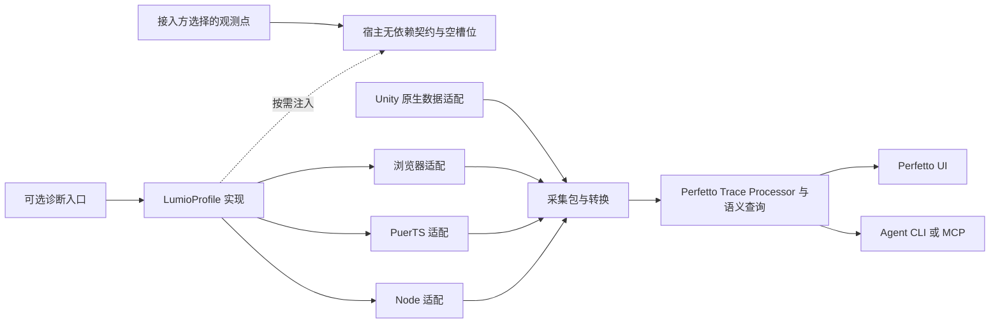

# 可选性能采集与分析插件设计

## 设计状态

已确认的产品方向见 [ADR-001](../../decisions/ADR-001-optional-plugin-and-perfetto.md)，无依赖宿主契约、可选注入与双层开关见 [ADR-002](../../decisions/ADR-002-host-contract-and-optional-injection.md)，一个采集包带三个环境子入口、工具和 Unity 原生包独立见 [ADR-003](../../decisions/ADR-003-runtime-subpaths-and-independent-tools.md)。产品约束见 [system](../../rules/system.md)。

具体声明与包职责见 [SDK 接口与包结构](sdk-contract.md)，三端最小接入及 Agent 命令见 [使用指引](../standards/integration-guide.md)。第一版本地实现见 [实际范围](mvp-runtime.md) 与 [运行指引](../standards/mvp-usage.md)；本页的完整产品方向不表示后续能力已经实现。

原始记录、时钟校准、身份、关联与转换以 [采集协议](capture-protocol.md) 为详细设计入口。普通 Trace 满时保留已有记录、丢弃新详细事件，循环覆盖显式选择，已确认见 [ADR-004](../../decisions/ADR-004-trace-overflow-policy.md)。

目标是让开发者和 Agent 从一次操作、一个行为、一帧或一个 tick 进入分析，区分执行区间、调度等待、队列等待、同步缓冲和表现成本。第一阶段聚焦单次采集，统计按需开启。

## 可选插件与接入方边界

| 状态 | 设计要求 |
| --- | --- |
| 未安装或构建排除 | 宿主正常构建、启动、联机与运行；默认运行依赖图不解析或加载插件 |
| 已安装但未装配 | 包没有启动采集器、注册定时器、开连接等导入副作用 |
| 已装配且 Off | 没有事件计时、参数构造、采集缓冲分配、采集定时器或采集数据上传；只允许经过验证的启用判断与必要静态元数据 |
| 明确启用 | 仅按所选范围采集；诊断失败、断连和缓冲压力不改变玩法控制流；开销单独计量 |

「有和没有都不能影响」首先约束宿主依赖和游戏语义。启用观测不可避免会消耗资源，性能影响通过限额与实测约束，不能以 no-op 或抽象接口的名称宣称零开销。

宿主若为了按需远程开启而显式保留控制连接或监听入口，该入口的固定资源成本也计入 Off 对照；控制入口响应能力查询不等于开启采集。包安装本身不创建这个入口，不能把控制链路成本隐藏在「采集关闭」之外。

本仓不为游戏自动埋点，不扫描并包裹全部函数，不更改渲染器、输入系统、队列算法或 GAS 行为。接入方可选择提供 scope、事件、计数器和关联信息；没有的语义显示为覆盖不足。

已确认采用「宿主持有轻量契约与空槽位，可选入口注入插件实现」。宿主声明不依赖插件类型或运行代码，可以由 Engine 提供并复用；不强制消费者安装独立 API 包。本仓提供参考契约、兼容实现与验证方法，接入方决定是否采用及提供哪些观测点。

普通构建的类型检查和模块图均排除可选集成模块，只有诊断构建才加入插件依赖。类型导入仍可能要求解析包，条件动态导入也不能通用保证无包可构建；需核验普通入口、公共导出与文件包含规则，并在插件物理缺席的隔离环境中验证。

所有通用插件能力归本仓。引擎、游戏是否增加观测点是各自的集成工作；游戏语义标记、事件名称、行为身份和启用策略不由本仓硬编码。

## Debug 与 Release

构建决定「具备哪些能力」，运行时状态决定「当前启用什么」，两者独立。

| 构建 | 默认状态 | 可提供的能力 | 边界 |
| --- | --- | --- | --- |
| Debug，保留诊断能力 | Off | 接口校验、语义记录与实际支持的原生诊断/采样 | 连接 Agent 不自动开启；测量时记录所有诊断选项 |
| Release，不包含插件 | 无采集能力 | 无 | 不下载或加载诊断依赖；不能远程开启 |
| Release，包含可选插件 | Off | 构建明确保留的统计、语义记录和平台支持的诊断数据源 | 宿主明确允许才可开启；被裁掉的数据源报告 unavailable |
| Debug 或 Release，完全裁剪 | 无采集能力 | 无 | 验证观测分支、调用、包装和依赖从实际产物移除；不能远程开启 |

Release 是否保留具体能力由接入方决定，不强制增加游戏构建类型。编译能力与运行状态分离的原则已确认，具体打包入口与裁剪方式尚未冻结。未安装只证明包可选，不自动证明宿主观测判断也已裁剪。

运行时 Off 不做采集，但仍有有限的判断与静态元数据成本。完全裁剪需要检查实际模块图与输出；不能把 no-op、环境变量或 tree-shaking 配置当作证明。Node 直接执行 TS 的类型剥离不等于消除观测分支，PuerTS 也必须检查其实际加载 JS；若需要完全裁剪，须选择并验证相应构建步骤。

候选运行模式：

| 模式 | 数据内容 |
| --- | --- |
| Off | 不采集；不保留隐式实时统计 |
| Stats | 所选计数器、分布和汇总；无逐操作详细链 |
| Trace | 所选观测点的区间、阶段与因果关联，可附带 Stats |
| Deep | Trace 加上明确选择的 CPU 采样、GPU 查询或原生详细捕获 |

模式可以进一步按类别、数据源、标记和实体筛选。CPU 采样、GPU 查询分别协商，不因进入 Deep 而假定全部可用。关闭判断在取时钟、字符串拼接、对象构造和跨语言调用之前执行。

Stats 与 Trace 使用独立可选槽位，Off 时均为空。热路径先检查编译能力和当前槽位，再构造只读诊断参数；仅启用 Stats 不构造 Trace 上下文。默认不以空方法或回调包装代替判断，避免参数求值、闭包与额外调用。PuerTS 的开关检查在 JS 侧完成，不跨 C# 询问是否开启。

启用请求携带时限、容量、过滤条件和构建允许的能力。到期、停止或控制租约失效后撤销该次采集，恢复此前模式；不覆盖另一已存在会话的配置。首期对同一数据源的冲突详细采集建议显式返回 busy，不静默叠加 Profiler。

## 统一接口与组件

采集端采用一个包的浏览器、PuerTS、Node 子入口；工具包和 Unity 原生包独立，不进入不需要它们的宿主依赖图。候选名称与导入方式见 [SDK 接口与包结构](sdk-contract.md)。以下是职责概念，不是已发布的 SDK 签名：

| 接口 | 职责 | 约束 |
| --- | --- | --- |
| Marker registry | 注册稳定名称、类别、单位和源码位置 | 热路径使用缓存句柄；实体 ID 不拼入标记名称 |
| Scope | 同一执行载体上的同步调用区间 | 正常返回和异常均闭合；不能跨 await、yield 或线程 |
| Event / Link | 阶段事件、异步操作、消息和因果边 | 父子调用与跨端关联分开表达 |
| Counter / Histogram | 数量、深度、分布和窗口汇总 | 有界维度；实体级信息用于短时筛选而非常驻标签 |
| Clock / Buffer / Sink | 单调时钟、缓冲、批量排出 | 不依赖具体宿主全局变量，不反压玩法 |
| Native data provider | CPU、GC、内存、GPU、原生 Profiler | 报告实际能力、覆盖范围、来源和单位 |
| Capture control | 发现、协商、启停、状态和导出 | 与业务观测接口分离 |

TS 接口在浏览器、PuerTS 和 Node 复用；Unity C# 侧提供原生适配，不迁移或重写 TS 玩法逻辑。通用层不依赖 window、process、Unity API、游戏代码或 Perfetto UI。

采集端只写紧凑有界记录。序列化大对象、压缩、合并、转换和查询放在非玩法热路径；协议编码与具体排出载体通过实验选择。

各执行上下文独立持有槽位和 writer，跨 Worker 共享协议与配置，不传递 writer 对象。标记描述与句柄在冷路径注册或启用时绑定，热路径复用。控制接口按能力发现、准备、开始、状态、停止、导出分离；装配与能力查询不启用采集。

观测回调的故障在诊断边界内隔离，宿主业务异常保持原有传播语义；不能为了结束 scope 吞掉业务异常，也不能让诊断异常打断业务。

已开始的同步区间保存原 writer、令牌和会话身份。停止撤销本次新写入入口，只在期限内收尾原区间；到期关闭旧 writer，迟到结束安全丢弃并报告质量信息。切换模式或重建环境不能把旧区间写入新会话，未结束区间保留不完整状态。关闭或裁剪不能删掉任何原本属于玩法的参数求值。

## 浏览器接入

主线程、预测 Worker、solo Room Worker 分别拥有数据源身份和缓冲。逻辑角色与实际线程分开：同一主线程中的游戏与客户端模块不因名字不同而被当成两个时钟。

候选原生来源包括 PerformanceObserver 支持的长任务等条目、RAF 机会、实际绘制、CDP CPU 采样及可用的 WebGL GPU 查询。长任务覆盖范围不能扩张为所有 Worker；采样需要逐个确认目标环境是否被覆盖。

浏览器 Profiler 由外部诊断适配器按需附加。附加不暂停 Worker，不激活窗口、不模拟焦点、不关闭后台节流。普通页面不具备的采样权限不能通过插桩接口假装存在。

WebGL 提交仅代表 CPU 提交区间。GPU timer query 需异步读取、检查可用性与 disjoint/context-loss，限制未完成查询数量；不使用 finish 等同步等待改变运行。没有 GPU 时钟映射时，只报告 GPU 区间时长，不伪造在 CPU 时间线上的精确位置。

## Unity 与 PuerTS 接入

浏览器和 Unity 复用现有 TS 逻辑；PuerTS 运行 TS，Unity 承担原生表现。插件不要求 Unity 使用 Web Worker，也不替宿主决定预测线程布局。

PuerTS 有不同脚本后端；V8 后端仅提供 ECMAScript，不自动包含浏览器或 Node API。因此由适配器注入单调时钟和排出能力，不能依赖 performance.now 天然存在。计时不能用缩放后的游戏时间或每帧只更新一次的值。[PuerTS 官方说明](https://github.com/Tencent/puerts)

建议采用下列分工：

| 层 | 采集方式 |
| --- | --- |
| TS 语义 | 使用共用接口，先写 TS 侧缓冲，按预算批量排出 |
| TS 与 C# 边界 | 接入方选择的原生入口、回调或表现批次记录关联；不默认拦截全部桥接调用 |
| C# 区间 | 缓存 ProfilerMarker，记录同步原生工作 |
| Unity 统计 | ProfilerRecorder 读取实际可用计数器与时间指标 |
| 原生详细捕获 | 在支持的开发配置下，由 Editor 侧导出适配器读取逐帧、逐线程数据，再转换关联 |
| TS CPU 采样 | 按 PuerTS 后端、版本、平台与实际暴露接口验证；不可用时保留语义区间并报告缺项 |

避免为每个 TS scope 额外跨到 C# 调用 Marker。计时函数自身若需要跨界，其成本必须纳入测量；若不满足预算，应限制该档粒度或选择其他时钟适配，不能把批量排出时间当作事件发生时间。

同步桥接可记录 TS 包围区间和 C# 内部区间。差值只能标为「跨界及未覆盖成本」，不能自动解释为纯桥接开销。异步调用单独记录入队、出队和执行，不能强行做同步相减。

同一次工作在 Lumio 与 Unity 原生捕获中可能重复出现，需要关联并选择统计来源，不能累加。原生 Marker 的调用树不是 CPU 统计采样；ProfilerRecorder 也不是完整调用树导出器。[ProfilerMarker](https://docs.unity.com/en-us/engine/6000.0/script-reference/unity/profiling/profilermarker) · [ProfilerRecorder](https://docs.unity3d.com/6000.0/Documentation/ScriptReference/Unity.Profiling.ProfilerRecorder.html)

RawFrameDataView 提供 Editor 侧逐帧逐线程访问能力；这是待验证的导出路径，不代表 Release Player 可以直接使用 UnityEditor API。Release 被编译移除的 Marker 无法靠开关恢复；若宿主选择保留 Release 语义记录，其启用路径需独立明确。[RawFrameDataView](https://docs.unity.com/en-us/engine/6000.0/script-reference/unityeditor/profiling/rawframedataview)

## 服务器接入

Node Host 与各 Room Worker 独立注册实例；观测点可以描述接收、未来 tick 缓冲、Worker 邮箱、输入队列、系统执行、提交、投影和发送，由接入方选择提供。

可选数据源包括事件循环、GC、内存和各执行环境 CPU profile。Host 的 CPU 采样不能代表全部 Room Worker；事件循环利用率也不能当作进程 CPU 利用率。[Node Inspector](https://nodejs.org/api/inspector.html)

solo Room 使用浏览器排出适配；真实 DS 使用 Node 排出适配。两者可复用语义协议，不能把 Node 文件写入作为 Room 采集的前提。每个房间有预算，Host 还应有进程总预算。

## 数据契约与关联

| 数据组 | 候选字段 |
| --- | --- |
| 会话与来源 | schemaVersion、captureId、sourceInstanceId、streamId、role、executionContext、process/thread 标识 |
| 时间 | localTime、原始表示与单位/频率、分辨率、clockId/clockEpoch、校准段与有效范围、映射误差 |
| 记录 | streamId + seq 事件引用、chunkSeq 批次引用、markerId、kind、spanId、parentSpanId、关联端点 |
| 接入方上下文 | world/epoch、session/connection 代次、input/action 序号、tick、frame、entity/behavior 标识 |
| 代码 | buildId、bundleHash、sourceMap/symbol 标识、codeRevision、热更代次 |
| 质量 | measurementKind、覆盖范围、丢弃区间、端点缺失、推断级别、原生支持状态 |

游戏字段可选、有命名空间且受容量约束；通用协议不以按键、GAS 或某款游戏为必填字段。大整数身份与序号不能经 JS Number 截断；编码需保证跨 TS/C# 往返一致。

关联优先复用接入方已经稳定的消息、会话和提交身份。新增诊断上下文属于可选元数据，不参与规则输入哈希、权威状态或资源结算；不支持的端点不强行补造关联。

按键可关联采样、输入序号、目标 tick、排队、系统、能力、提交、同步与表现。移动可用意图变化或行为段，拾取可用权威事件与实体发生实例，自动行为也可作为链根；是否提供这些标记由游戏决定。

预测、权威和另一玩家观察是分支图。确认、拒绝、取消、重复、旧会话和未观察到终点分别表达；缺失确认不等于拒绝。同一 actionSeq 在不同会话中不能相连。推断关联单独标记，不能与身份精确匹配混合统计。

### 时钟与生命周期

本地耗时先在本时钟域计算。跨域使用往返校准或可验证的同源时钟关系，保留原始时间、校准样本、有效期、漂移与不确定度；不能只依赖 timeOrigin 或 Date.now。

网络校准包含路径不对称的不确定性，不能由 RTT/2 推导真实单程延迟。串联映射需传播误差。无法对齐的来源保留独立时间域，禁止输出跨域差值；Perfetto 的可视化对齐不能替代精度证明。[Perfetto 时钟模型](https://perfetto.dev/docs/concepts/clock-sync)

页面或 Worker 重启、PuerTS 环境重建生成新实例；热更记录代码代次并标记无法证明连续的跨代区间。业务重连更新连接代次，业务会话按实际生命周期变化；诊断通道重连补传原批次而不重写身份。校准有效性独立验证，时钟未重置时不必伪造新时钟源。迟到旧事件保留原身份，不合入新操作。

### 分析口径

同线程自身耗时只能相对于实际观测到的同步子区间求并集后扣除；跨线程并行工作不能从父区间直接扣减。子区间丢失时完整自身耗时未知；即使没有丢失，也不能把未观测函数从统计口径中假定消失。

区间墙钟耗时可能含抢占、GC 和未观测工作。只有具备调度数据才能进一步判定 off-CPU；CPU 采样提供热点估计，不精确计时每个调用。

排队需要进入、可执行、出队等对应端点；未来目标 tick 等待、排队等待、同步插值和表现缓冲分开。重叠区间不重复求和；多个操作共享同一 tick 时，tick 总耗时不能分摊成每个操作的自身成本。

## Perfetto 与独立部署

建议在采集端之外将语义记录转换为原生 `.pftrace` 的轨道、区间、计数器与 flow，同时保留原始记录和质量元数据。时钟不能对齐的数据不得盲目合并。Chrome Trace JSON 可作为现有资料的兼容输入，不作为所有数据必须经过的中间层。[转换说明](https://perfetto.dev/docs/getting-started/converting)

转换前校验批次、诊断重传、身份、时钟与区间；不完整 begin/end 不补造成完整 Slice，纯操作归组不自动生成因果 Flow。质量数据也进入可查询内容，原始证据与派生结果分离；详见 [转换规则](capture-protocol.md#perfetto-转换)。

第一版复用 Perfetto UI 与 Trace Processor，补采集入口、质量概览、语义查询和结果导航。优先使用 SQL 模块、宏和托管/嵌入能力；深入定制 UI 需要单独评估构建维护，不假设可任意侧载插件。[UI 托管](https://perfetto.dev/docs/visualization/embedding-the-ui) · [分析扩展](https://perfetto.dev/docs/visualization/extension-servers) · [UI 插件](https://perfetto.dev/docs/contributing/ui-plugins)

工具支持本地文件工作流，分享或远端存储可选；游戏不依赖分析服务在线。首期不建设持续汇聚、长期检索、告警或业务平台集成。

## 开销与容量候选预算

以下为讨论中的验收目标，不是已有性能结果，也不是对所有硬件的保证。Deep 的外部采样成本单独报告，不能套用 Trace 预算。

| 档位 | 候选目标 |
| --- | --- |
| 包缺席/被排除 | 插件运行代码与加载请求为零；宿主正常启动和运行 |
| 已装配 Off | 热路径无采集计时与分配；额外 CPU 目标 ≤0.2%，低于测量噪声时报告噪声范围而非宣称零 |
| Stats | 额外 CPU 目标 ≤1%；帧/tick p99 增量目标 ≤0.1ms；每数据源统计内存目标 ≤256KiB |
| Trace | 额外 CPU 目标 ≤5%；帧/tick p99 增量目标 ≤0.5ms；默认窗口建议 15s，总时限建议 60s |
| Deep | 标注实际启用项、采样间隔及观察者开销；不默认启用 |

容量候选为浏览器每来源 8MiB、每页面 32MiB，DS 每 Room 4MiB、每进程 128MiB；PuerTS 与 C# 缓冲合计计入客户端预算，设备级上限需实测。默认导出目标 ≤64MiB 压缩体积，并设 ≤128MiB 解压上限；不得通过截断而隐瞒缺失。

字典、待闭合操作、排出队列、待确认批次、质量信息和导出任务也必须计入总预算。普通 Trace 默认保留已有记录，满时丢新详细事件；循环覆盖最旧批次必须显式选择。有限预留用于身份、校准、丢弃和区间收尾，不能保证关键记录永不丢失；质量无法可靠维护时终止该来源详细采集并报告。具体分类见 [缓冲与丢弃策略](capture-protocol.md#缓冲与丢弃策略)。

Stats 不保留逐操作历史。故障前详细数据必须来自事先启用的详细采集；希望保留最近窗口时可显式选择循环 Trace，不能在触发后恢复未记录信息。运行时关闭与完全排除包分别测量。

开销验证采用同构建、同场景、同负载的无插件/Off/Stats/Trace/Deep 对照，交错重复测量，区分冷启动与稳态，报告样本数、分布和噪声。单独记录时钟读取、单记录、批量排出、PuerTS 跨界、序列化与导出的成本，以及是否改变 GC 行为。不能只用空循环微基准代替真实帧/tick 测试。

敏感信息按白名单采集：不默认收集键盘文本、令牌、完整地址、账号标识、世界快照或源码正文；关联身份可使用会话内假名。源码映射与原始 profile 可作为单独受控附件。默认本地保存，不自动上传公共分析站点。

## 范围与验收分层

下表是设计范围及验证标准，不是实现排期或已派发任务。验收可使用合成宿主和接入方自愿提供的样例，本仓不承担游戏埋点改造。

| 层次 | 范围 | 可验证标准 |
| --- | --- | --- |
| 接入契约 | 可选装配、构建能力、Off、语义模型 | 插件物理缺席时可构建运行；安装不启动采集；Off 计时/参数构造/写入/采集跨界计数为零；完全裁剪有产物证据；异常与缓冲压力不改变宿主语义；跨语言身份往返一致 |
| 首期闭环 | 短时会话、按需 Stats、三类适配的统一协议、Perfetto、Agent 查询 | 支持的来源导出后可复查；各来源能力与缺失可见；同一查询在 UI 和 Agent 中口径一致；时钟不足时拒算跨端耗时 |
| 深入诊断 | 平台支持的 CPU/GPU、Unity 原生逐帧数据、特定实体和行为下钻 | 与原生工具对照；无重复计费；实际支持矩阵通过目标构建验证；开销独立报告 |
| 暂缓 | 长期在线聚合、告警、自研完整时间线、自动全函数插桩、普遍物理呈现测量 | 不作为首期依赖或交付承诺 |

Unity 原生全量捕获不是首期基础语义接入的前提。PuerTS 的具体后端与版本、GPU 平台和原生导出能力，必须形成经实测的支持矩阵后才可对外承诺。

## 历史现象作为归因验收样例

这些场景来自用户提供的既有排障背景，本仓没有重新复现；用于检验分析口径，不代表插件已经产出相应结论。

| 输入场景 | 工具应给出的归因 | 不得给出的结论 |
| --- | --- | --- |
| 目标推到未来约 32 tick，等待约 1.5s | 目标 tick 提前量及目标等待与执行分别呈现 | 自动归为网络传输慢 |
| 重连后旧输入堵塞，新操作等待 1043ms，规则执行约 9ms | 队列端点、深度、会话与对应 tick 区间 | 把 1043ms 算成规则执行；把整 tick 的 9ms 算成单能力自身耗时 |
| 约 32Hz RAF 机会，实际绘制约 16fps | RAF 机会、实际 draw、跳过原因与节拍余数证据 | 没有 GPU 数据便归为 GPU 慢 |
| 冷启动 WebGLProgram、PMREM 热点 | 原生采样热点与启动阶段关联，说明采样性质 | 把 CPU 栈采样当 GPU 执行或屏幕呈现时间 |
| 拒绝、取消、重复、旧会话与缺失端点 | 对应状态分开，跨会话不串链，未知保留未知 | 只统计成功样本或补造终点 |

## 继续讨论的设计项

| 议题 | 当前建议 | 尚需明确的内容 |
| --- | --- | --- |
| 契约签名与构建集成 | 已确认宿主无依赖契约、空槽位、双层开关和一个采集包的三环境子入口；具体声明见 [接口草案](sdk-contract.md) | 方法签名、版本协商、参考声明分发、正式包名与导出映射、各端裁剪适配 |
| 默认 Trace 粒度 | 支持接入方选择系统/回调/队列/表现批次 | 插件提供哪些预设；不代替游戏决定埋点 |
| PuerTS 原生桥接 | TS 缓冲批量排出，原生边界单独关联 | 目标后端/版本、单调时钟来源、跨界成本与采样接口 |
| Agent 控制入口 | CLI 为基础，MCP 包装同一能力 | 首期控制接入范围、会话授权及冲突处理细节 |
| 编码与资源预算 | 热路径紧凑记录、批量编码、工具侧生成原生 Perfetto；普通 Trace 丢新与显式循环策略已确认 | 编码布局、批次尺寸、预算数值、预留与重传参数、目标硬件和基准方法 |
| 校准与关联细节 | 原始时间、分段校准与误差、事件身份、因果与归组分离，见 [采集协议](capture-protocol.md) | 校准频率与有效性阈值、漂移约束、关系枚举及语义清单映射 |
| Unity 原生导出 | 支持环境下的 Editor 侧适配 | 接入深度、代码符号、时间映射与重复记录识别 |
